<div align="center">


# Tmatar Mart Partner

**Delivery partner app for Tmatar Mart, a fresh grocery delivery service**
<br/>
_Taaza Har Baar, Seedha Ghar Tak_


</div>

Riders log in with their phone number, go online, accept nearby orders, follow a real road route to the store, check every item at pickup, deliver against a customer signature and keep track of what they earned. The whole app runs against a built-in mock backend, so it works out of the box with no server or API keys.

## Screenshots

| Splash | Login | OTP | Home | Orders |
| :---: | :---: | :---: | :---: | :---: |
| 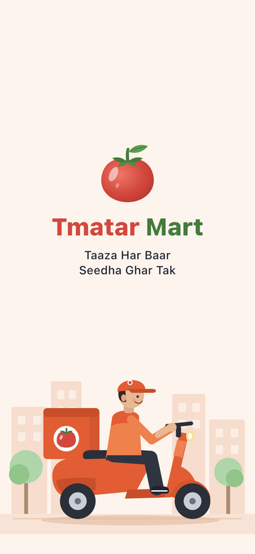 | 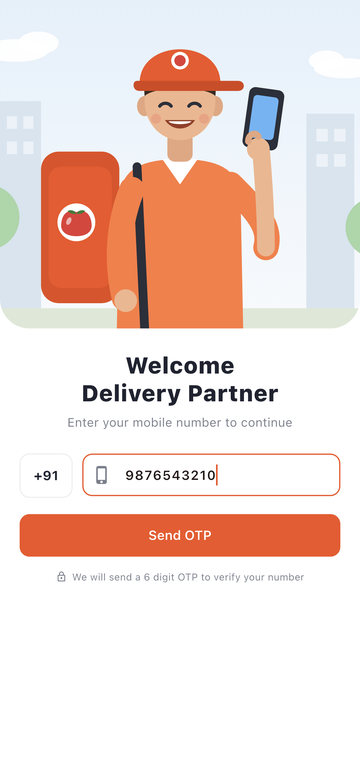 | 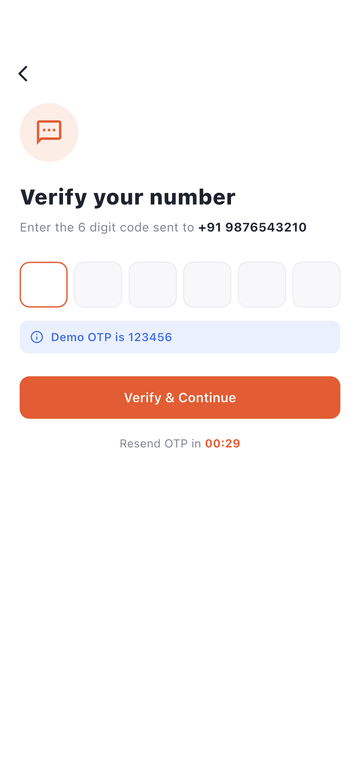 | 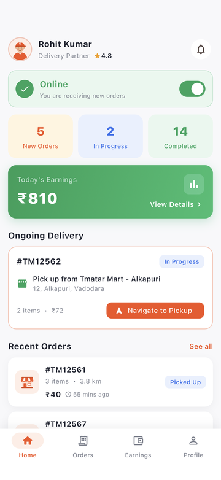 | 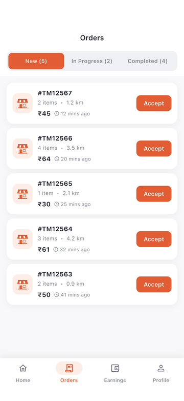 |

| Order details | Navigate to pickup | Pickup check | Navigate to customer | Delivery |
| :---: | :---: | :---: | :---: | :---: |
| 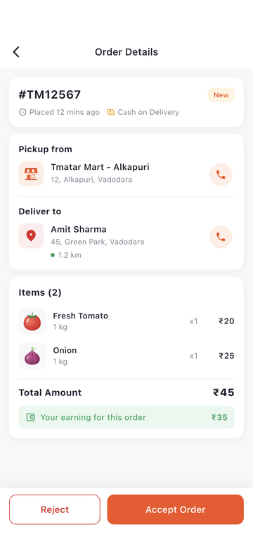 | 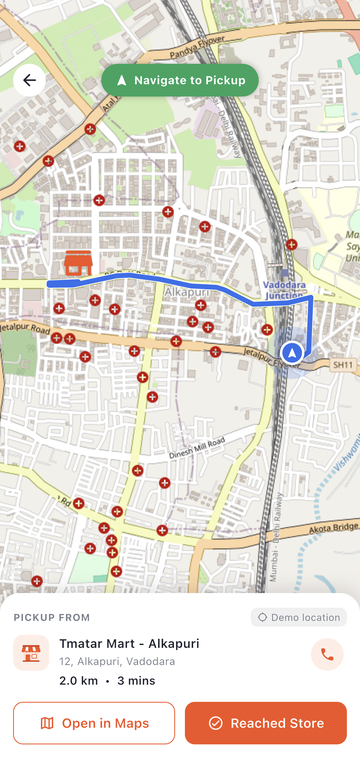 | 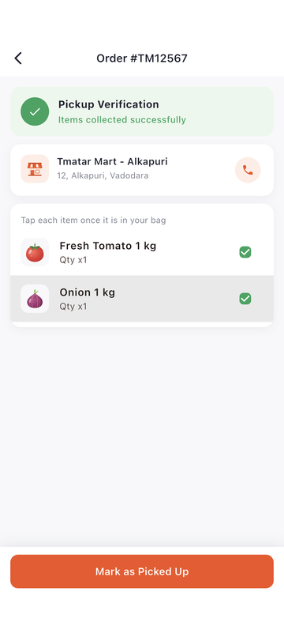 | 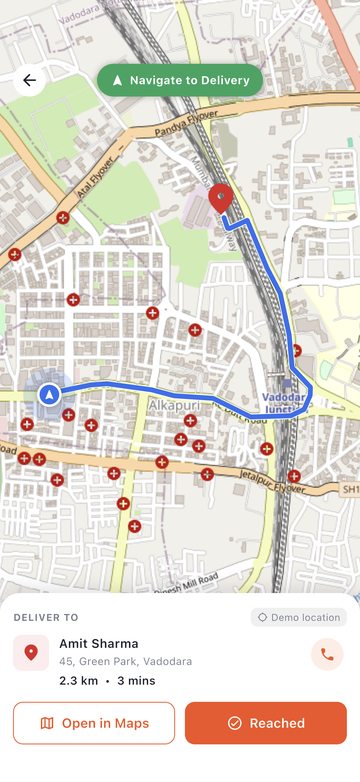 | 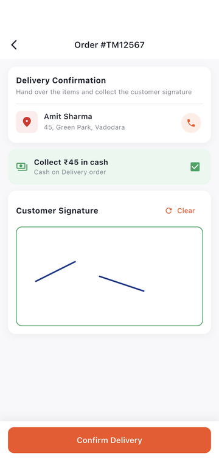 |

| Delivered | History | Earnings | Profile | Edit profile |
| :---: | :---: | :---: | :---: | :---: |
| 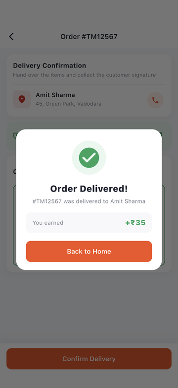 | 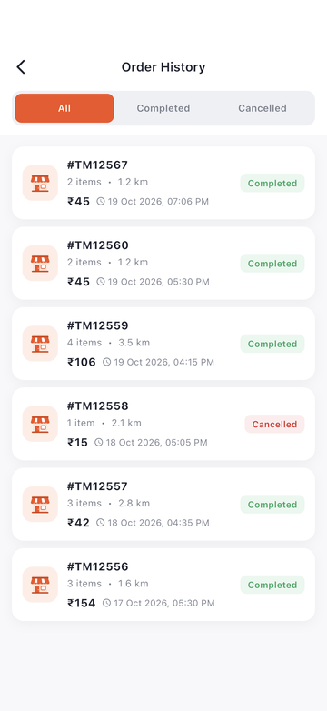 | 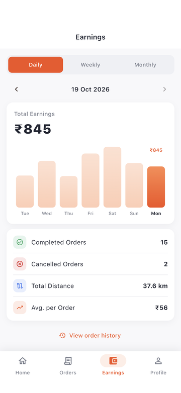 | 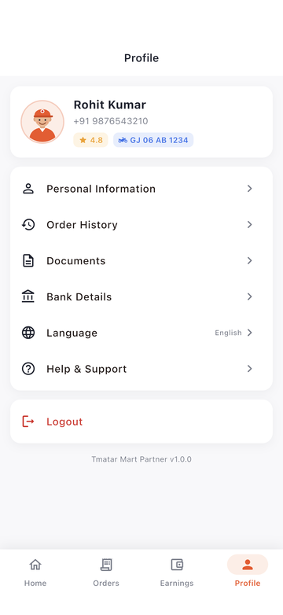 | 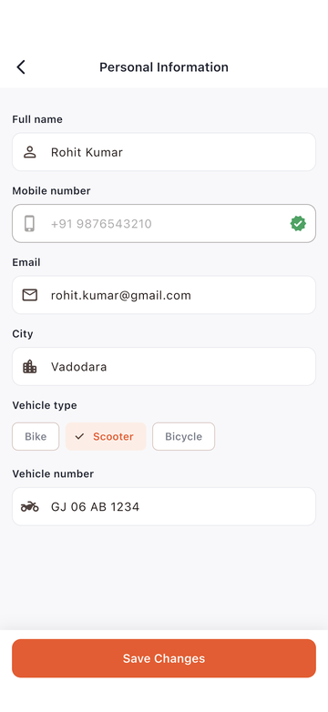 |

## Try it

```bash
flutter pub get
flutter run
```

| | |
| --- | --- |
| Mobile number | any valid Indian mobile, e.g. `9876543210` |
| OTP | **`123456`** |

## Features

**Account**
- Phone + 6 digit OTP login with validation and a resend timer
- Session is kept between launches; an expired token signs you out automatically

**Dashboard**
- Online / Offline switch (offline partners can't accept orders)
- New, in progress and completed counts, today's earnings
- Ongoing delivery card that jumps straight to the next step

**Orders**
- New / In Progress / Completed tabs with counts and one-tap accept
- Order details with store and customer contact, items with images, order total and your earning
- Accept, or reject with a reason
- Progress tracker: Accepted → Picked Up → Delivered

**Navigation**
- OpenStreetMap map with a real road route from [OSRM](https://project-osrm.org/), road distance and travel time
- Uses the rider's live GPS position and re-routes as they move
- "Open in Maps" hands off to Google Maps for turn-by-turn directions
- Falls back gracefully: demo rider position when GPS is off or you're outside the service city, and a dashed straight line if routing is unavailable

**Pickup and delivery**
- Pickup checklist: every item must be ticked before the order can be marked as picked up
- Delivery confirmation with a cash collection check for COD orders and a required customer signature
- Success screen with the amount earned

**Earnings and history**
- Daily, weekly and monthly earnings with date navigation, bar chart, completed and cancelled orders, distance and average per order
- Order history filtered by All / Completed / Cancelled

**Profile**
- Edit personal and vehicle details with validation, documents, bank details, support and logout

**Everywhere**
- Loading, empty and error states with retry, pull to refresh, native splash screen

## Order flow

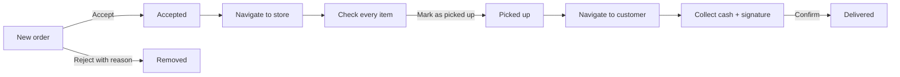

The server enforces the flow: an invalid step returns `409`, accepting while offline returns `403`.

## Tech stack

| | |
| --- | --- |
| State management | `flutter_bloc` with `freezed` events and states |
| Navigation | `go_router` with a `StatefulShellRoute` for the bottom bar and an auth redirect |
| Networking | `dio` with a response envelope, typed `ApiException` errors and auto sign-out on `401` |
| Dependency injection | `get_it` |
| Maps and location | `flutter_map` + OpenStreetMap tiles, OSRM routing, `geolocator` |
| Other | `signature`, `url_launcher`, `shared_preferences`, `intl`, `flutter_svg` |

All illustrations, product images and the logo are hand-made SVGs in `assets/images/`.

## Project structure

```
lib/
├── core/
│   ├── constants/     app constants and asset paths
│   ├── di/            get_it setup
│   ├── location/      GPS access and permissions
│   ├── network/       ApiClient, endpoints, ApiException
│   ├── router/        routes and the bottom navigation shell
│   ├── storage/       session storage
│   ├── theme/         colours, text styles, radii, shadows, ThemeData
│   └── utils/         formatters, validators, launcher helpers
├── data/
│   ├── mock/          in-memory backend + Dio interceptor
│   ├── models/        freezed models
│   └── repositories/  auth, orders, earnings, profile, routing
├── features/
│   └── <feature>/     bloc/ · screens/ · widgets/
│                      splash, auth, home, orders, history, earnings, profile
└── shared/widgets/    reusable UI (buttons, cards, chips, state views, ...)
```

## Mock backend

There is no real server. `MockApiInterceptor` answers every request from an in-memory `MockDeliveryServer` with about 600 ms of latency, the usual `{ success, data, message }` envelope and real HTTP status codes. To point the app at a real backend, remove the interceptor in `lib/core/di/injection.dart`.

| Method | Endpoint |
| --- | --- |
| `POST` | `/api/auth/send-otp` |
| `POST` | `/api/auth/verify-otp` |
| `GET` | `/api/delivery/orders?status=new\|in_progress\|history` (history also takes `filter=all\|completed\|cancelled`) |
| `GET` | `/api/delivery/orders/{id}` |
| `POST` | `/api/delivery/orders/{id}/accept` · `reject` · `pickup` · `deliver` |
| `GET` | `/api/delivery/earnings?period=daily\|weekly\|monthly&date=yyyy-MM-dd` |
| `GET` / `PUT` | `/api/delivery/profile` (`PUT {is_online}` toggles availability) |

Routing is the only real network call: it goes straight to the public OSRM server on its own client.

## Tests

```bash
flutter test
```

Covers the mock API: login, the full order flow, and the `400`, `401`, `403` and `409` cases, plus OSRM route parsing.

An end-to-end test drives the whole app, from login through delivery to profile, and saves a screenshot of every screen to `build/screenshots/`:

```bash
flutter drive --driver=test_driver/integration_test.dart \
  --target=integration_test/app_flow_test.dart -d <device>
```

On the iOS simulator, set a location and grant permission first so no system alert interrupts the run:

```bash
xcrun simctl location booted set 22.3080,73.1795
xcrun simctl privacy booted grant location com.tmatarmart.tmatarDelivery
```

## Code generation

After changing any `freezed` class:

```bash
dart run build_runner build
```
